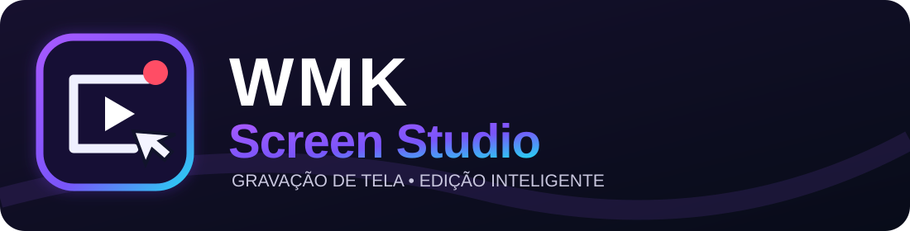

<p align="center">
  
</p>

<p align="center"><strong>Grave, destaque, edite e apresente seus vídeos com qualidade profissional.</strong></p>

<p align="center">
  
  
  
  
</p>

# WMK Screen Studio

O **WMK Screen Studio** é um fork do projeto livre [Capptivo](https://github.com/SECHAK-AG/capptivo), criado para gravar a tela e editar vídeos de demonstração, aulas, tutoriais, apresentações e documentação de programas. Inclui zoom inteligente que acompanha o cursor, sugestões de zoom baseadas nos cliques, anotações na tela, personalização visual, webcam e legendas locais com Whisper.

> **Estado do projeto:** a documentação e a identidade visual do fork foram personalizadas. O código do aplicativo continua baseado no Capptivo 1.0.4; a mudança do README e do logotipo **não significa** que a interface, o nome exibido no executável ou os ícones dos instaladores já foram substituídos. Consulte os workflows para verificar se cada compilação passou.

**Navegação:** [Instalação](#instalação) · [Compilação automática](#compilação-automática-no-github-actions) · [Requisitos](#requisitos-e-sistemas-compatíveis) · [Recursos](#recursos) · [Desenvolvimento](#desenvolvimento-local) · [Arquitetura](#arquitetura) · [Diagnósticos](#diagnósticos-locais) · [Licença e créditos](#licença-e-créditos)

---


- **[Manual de servidores e reuniões para iniciantes](manual-servidor-reunioes-iniciantes.html)** — explicação VPS, DNS, Docker, Jitsi, HTTPS, firewall, testes em celular, problemas comuns e integração futura com Meeting/Classroom.

- **[Jitsi explicado do zero: ferramentas gratuitas e menor custo](guia-jitsi-e-ferramentas-gratuitas.html)** — o que é Jitsi, exemplos práticos, servidores, celulares, alternativas livres e custos reais.

- **[WMK Meeting Studio — criar sala e entrar pelo celular](wmk-meeting-studio.html)** — protótipo responsivo, convites com nome aleatório, link para compartilhar e incorporação opcional do Jitsi. Requer acesso à internet e servidor Jitsi externo; não oferece autenticação própria.
- **[Manual de integração Jitsi para desenvolvedores](manual-jitsi-integracao-desenvolvedores.html)** — exemplos HTML/React, servidor próprio, requisitos de segurança, extensões para aulas, IA individual e testes.

## Pesquisa de mercado e planejamento público

- **WMK Live Video Helper (experimental):** painel **Análise de audiência → Meus vídeos no chat** para cadastrar links de vídeos do YouTube, pesquisar por título/assunto, abrir prévia privada e copiar resposta com link para o chat. O vídeo ainda **não** é sobreposto à gravação nem enviado automaticamente ao YouTube; isso depende do futuro compositor e de OAuth.


- **[Legendas com IA e assistente ao vivo — manual](manual-legendas-assistente-live.html)** — importar/exportar SRT/VTT, verificar legibilidade, aplicar presets, preparar análise com IA e selecionar perguntas de espectadores para consultas privadas. Os conectores de IA e o chat em tempo real continuam pendentes de implementação e teste.


- **[WMK Video Doctor (Python)](tools/wmk_video_doctor.py)** — diagnóstico experimental de arquivos exportados com FFprobe/FFmpeg: faixas de vídeo/áudio, duração e trechos escuros. Ainda não integrado ao Tauri e não substitui testes reais de captura.


- **[WMK Creator Dashboard — bônus gratuito](wmk-creator-dashboard.html)** — painel para canais pequenos com perguntas frequentes, gráficos, dicas práticas, dados opcionais de vídeos e relatório HTML.
- **[Manual do Creator Dashboard](manual-creator-dashboard.html)** — guia em português, exemplos de importação, métricas e uso de IA opcional.


- **[Contrato OpenAPI da Audience API](docs-api/audience-openapi.json)** — especificação REST versionada para integrar dashboards, reuniões e aplicações externas.
- **Painel nativo experimental:** a biblioteca do editor Tauri agora possui a entrada **Análise de audiência**, com importação CSV/JSON e abas para perguntas, assuntos e ideias. A integração ainda precisa ser compilada e testada no Windows.


- **[Manual da API Audience (HTML)](manual-audience-api.html)** — importar lives, consultar informações por API local com chave e gerar relatórios com gráficos para reuniões.
- **[Código da API Audience (Python)](tools/audience_api.py)** — módulo independente, gratuito, baseado em SQLite e biblioteca padrão.


- **[WMK Audience Intelligence — protótipo HTML funcional](wmk-audience-intelligence.html)** — importe chats CSV/JSON e analise perguntas, assuntos e ideias para próximos vídeos, localmente e sem contratar IA.


- **[Lista técnica de Cenas, Múltiplas Fontes e IA (HTML)](tarefas-cenas-ia.html)** — 51 tarefas, critérios de aceite, acompanhamento e exportação JSON.


- **[Relatório comparativo de 10 ferramentas (HTML)](relatorio-mercado.html)** — recursos, limitações, feedback qualitativo, fontes e oportunidades para o WMK Screen Studio.
- **[Roadmap público (HTML)](roadmap.html)** — versões planejadas, prioridades, critérios de aceite e acompanhamento transparente do projeto.

> Estes documentos estão em português e distinguem funcionalidades existentes de propostas futuras. O código principal do Capptivo segue MIT, com obrigações adicionais para dependências de terceiros.

## Instalação

### Instaladores do WMK Screen Studio

Acesse o [GitHub Actions deste fork](https://github.com/WalneyNF/WMK-Screen-Studio/actions/workflows/wmk-windows-build.yml) para executar o workflow **WMK - Compilar Windows**. Quando terminar **com sucesso**, abra a execução e baixe o artefato **WMK-Screen-Studio-Windows-x64**, que deve conter um instalador `.exe` (NSIS) e outro `.msi`. São instaladores **sem assinatura digital**; o Windows poderá exibir um aviso de segurança. A compilação depende de o workflow funcionar corretamente.

Para consultar os **instaladores originais do Capptivo** (que não incorporam necessariamente as alterações deste fork), visite os [releases oficiais do projeto-base](https://github.com/SECHAK-AG/capptivo/releases).

| Sistema | Formatos normalmente gerados pelo projeto original |
| --- | --- |
| Windows x64 | `.msi` ou `-setup.exe` |
| macOS Apple Silicon | `aarch64` — `.dmg` ou `.app.tar.gz` |
| macOS Intel | `x64` / `x86_64` — `.dmg` ou `.app.tar.gz` |
| Linux | `.deb`, `.AppImage` ou `.rpm` |

**macOS:** os pacotes do projeto original podem não estar notarizados. Na primeira abertura, use as opções de segurança do macOS e autorize a gravação da tela.

**Legendas:** exigem o executável `whisper-cli` do projeto [whisper.cpp](https://github.com/ggerganov/whisper.cpp) instalado no sistema. O aplicativo pode baixar os pesos do modelo na primeira utilização; não depende de uma API em nuvem para transcrever.

## Compilação automática no GitHub Actions

O fork possui o workflow [WMK - Compilar Windows](https://github.com/WalneyNF/WMK-Screen-Studio/actions/workflows/wmk-windows-build.yml):

1. Acesse a página do workflow.
2. Selecione **Run workflow** e confirme a execução na branch `main`.
3. Acompanhe as etapas de instalação, testes, obtenção do FFmpeg e compilação Tauri.
4. Caso a execução fique verde, baixe o arquivo em **Artifacts**.
5. Extraia o ZIP e instale o `.exe` ou `.msi` em um ambiente de testes.

O workflow de desenvolvimento não precisa das chaves de assinatura da atualização automática. Seus instaladores são destinados a testes; publicar um release confiável exige verificações adicionais.

### Publicação oficial com assinatura

O workflow [Release](https://github.com/WalneyNF/WMK-Screen-Studio/actions/workflows/release.yml), herdado do Capptivo, é mais rigoroso e compila Windows, macOS e Linux. Ele exige uma tag existente no formato `vMAJOR.MINOR.PATCH` e a versão deve coincidir em `package.json`, `src-tauri/tauri.conf.json`, `src-tauri/Cargo.toml` e na entrada do pacote desktop em `src-tauri/Cargo.lock`.

Exemplo de preparação de tag, **somente depois de atualizar todas as versões**:

```bash
git tag v1.0.5
git push origin main
git push origin v1.0.5
```

O workflow original requer, no ambiente protegido `release`, os segredos `TAURI_SIGNING_PRIVATE_KEY` e `TAURI_SIGNING_PRIVATE_KEY_PASSWORD`. Os pacotes Windows do projeto-base não possuem assinatura Authenticode, e os pacotes macOS não são notarizados. **Não presuma que o atual workflow de release já foi adaptado completamente ao fork**: os scripts de publicação e endpoints herdados precisam ser revisados antes de um release oficial. Preserve as permissões mínimas do `GITHUB_TOKEN`.

## Requisitos e sistemas compatíveis

- **Windows:** Windows 10 versão 2004 (build 19041) ou posterior. O backend de captura requer GPU/adaptador com **Direct3D feature level 11_0** ou superior.
- **macOS:** versão 13 ou posterior; conceda a permissão de gravação de tela.
- **Linux:** distribuição moderna com **PipeWire 1.0+**, como Ubuntu 24.04, em X11 ou Wayland.

### Como a gravação funciona em cada sistema

| Sistema | Captura e áudio |
| --- | --- |
| Windows | Windows.Graphics.Capture, áudio do sistema via WASAPI loopback; tentativa de aceleração por NVENC, QuickSync, AMF ou Media Foundation. |
| macOS | ScreenCaptureKit, VideoToolbox para H.264 e fluxo complementar de áudio. |
| Linux | xdg-desktop-portal e PipeWire; áudio por monitor PulseAudio/PipeWire. |

**Limitação no Linux:** não há seleção nativa de área nesse backend; use o recorte no editor. Em Wayland, o acompanhamento do cursor depende de metadados oferecidos pelo portal/PipeWire. Quando indisponíveis, o mouse aparece incorporado à gravação, sem dados separados para acompanhamento de zoom.

## Recursos

### 1. Gravação de tela

- Gravação de monitor, janela e, onde compatível, uma área personalizada.
- Sobreposição de webcam.
- Microfone com seleção de dispositivo e áudio do sistema.
- Contagem regressiva, pausa e retomada.
- Anotações durante a gravação.
- Atalho global **Alt+Shift+R** no Windows/Linux; **⌥⇧R** no macOS.
- Captura nativa por sistema, codificação H.264 e MP4 fragmentado para maior tolerância a falhas.
- Registro de cursor e cliques a 60 Hz em `cursor.json`.
- Idiomas disponíveis no aplicativo original, incluindo português; a extensão da tradução deve ser verificada na interface.


### 2. Anotações na tela

A barra flutuante permite selecionar elementos sem impedir o uso normal da área de trabalho quando está inativa.

- Caneta, marca-texto e borracha.
- Retângulo, elipse, linha, seta e texto.
- Cores predefinidas ou personalizadas e tamanho do traço.
- Desfazer, refazer e limpar.
- Barra arrastável; a tecla **Esc** fecha painéis e sai da ferramenta conforme o contexto.


### 3. Zoom inteligente e movimento

- Fragmentos de zoom na linha do tempo, com atalho **Z**.
- Sugestão automática de zoom a partir dos cliques de uma gravação nova.
- Acompanhamento do cursor, com deslocamento suave.
- Áreas fixas de zoom, ajustáveis por arraste.
- Opção de aplicar zoom apenas à gravação ou à cena com fundo.
- Controle de escala, suavização e aceleração/desaceleração das transições.
- Redução opcional de margens do fundo e do tamanho da webcam durante o zoom.
- Transições automáticas entre fragmentos.


### 4. Personalização do cursor

- Exibir ou ocultar cursor composto na edição.
- Estilos macOS, Tahoe, Tahoe invertido e Minimal.
- Tamanho, desfoque de movimento, animação do clique e balanço do cursor.


### 5. Aparência e composição

- Fundos com imagens, cores sólidas, degradês e imagens próprias.
- Ajuste de cores e ângulo do degradê.
- Presets nomeados para salvar e reaplicar aparência, webcam, cursor, legendas e exportação.
- Recorte de conteúdo para ocultar barras ou áreas desnecessárias.
- Margens, cantos arredondados, sombras, desfoque e escurecimento do fundo.


### 6. Webcam

- Sobreposição circular ou retangular (imagem sobre imagem).
- Espelhamento, posição, margens e dimensões.
- Arredondamento, sombra e recorte.
- Ajuste opcional do tamanho da webcam durante o zoom.

### 7. Legendas automáticas

- Transcrição de fala local com **Whisper via whisper.cpp**.
- Modelo de reconhecimento que pode ser baixado.
- Estilo de legendas e incorporação na prévia e no arquivo exportado.


### 8. Linha do tempo

- Reprodução, navegação e ajuste da composição.
- Criação, sugestão, seleção, redimensionamento, divisão e exclusão de zooms.
- Remoção de intervalos com atalho **T**.
- Desfazer/refazer, ajuste de escala da linha do tempo e redefinição de fragmentos.

### 9. Exportação

- **MP4, WebM e GIF**.
- Resoluções predefinidas até a resolução original.
- Ajustes de qualidade de codificação e qualidade das cores do GIF.
- Taxas de **24, 30 ou 60 FPS**.
- Aprimoramento opcional da voz.
- Progresso, seleção de pasta, notificação e abertura do arquivo no gerenciador.


### 10. Projetos locais

- Gravações armazenadas na pasta de dados do aplicativo (AppData / Application Support / XDG).
- Biblioteca de gravações e renomeação de projetos.
- Não exige conta para gravar ou editar.
- Registro de dados do cursor separado do vídeo.

## Desenvolvimento local

### Pré-requisitos

- **Rust 1.98.0**, com componentes rustfmt e Clippy.
- **Node.js** na versão indicada em [`.node-version`](.node-version).
- **Corepack**, que usa o pnpm fixado em `package.json`.
- Ferramentas nativas de compilação da plataforma. No Windows, requer **MSVC C++ Build Tools**, incluindo `link.exe`.

Clone e execute:

```bash
git clone https://github.com/WalneyNF/WMK-Screen-Studio.git
cd WMK-Screen-Studio
corepack pnpm install
corepack pnpm tauri dev
```

O script `scripts/fetch-ffmpeg.mjs` busca os executáveis FFmpeg e ffprobe por plataforma e verifica tamanho e SHA-256 com o manifesto `scripts/ffmpeg-sidecars.json`. Os binários são renomeados para evitar colisões com instalações do sistema.

### Rust portátil no Windows

É possível manter o Rust 1.98.0 em `.local`, sem substituir a instalação global. A ferramenta precisa estar previamente disponível nessa pasta.

```powershell
powershell -ExecutionPolicy Bypass -File scripts/with-local-rust.ps1 corepack pnpm tauri dev
```

O lançador procura o toolchain MSVC validado em `.local/rustup/toolchains/1.98.0-x86_64-pc-windows-msvc/bin` e mantém o cache e a saída do Cargo em `.local`. Não instala Rust automaticamente e não substitui as ferramentas C++ de compilação.

### Testes e verificações

```bash
corepack pnpm lint
corepack pnpm test
corepack pnpm build
corepack pnpm tauri dev
```

Rust (na pasta `src-tauri`):

```bash
cargo test --no-default-features
cargo check --no-default-features
```

Rust portátil no Windows:

```powershell
powershell -ExecutionPolicy Bypass -File scripts/with-local-rust.ps1 cargo test --manifest-path src-tauri/Cargo.toml --no-default-features
powershell -ExecutionPolicy Bypass -File scripts/with-local-rust.ps1 cargo check --manifest-path src-tauri/Cargo.toml --no-default-features
```

## Arquitetura

```text
Captura  → canal limitado de quadros → FFmpeg / VideoToolbox → screen.mp4
Cursor   → cursor.json
Interface React → IPC tipado → serviços Rust
Editor   → media:// (HTTP Range) + composição em canvas → exportação
```

O backend **Rust** cuida da captura, codificação e persistência. O frontend **React + TypeScript** apresenta a interface; os módulos de domínio não devem depender diretamente de `tauri::*`.

```text
src-tauri/src/
├── recorder/   # backend de captura e codificador
├── cursor/     # rastreamento de ponteiro a 60 Hz
├── project/    # armazenamento local e esquema
├── commands/   # adaptadores IPC
└── ...         # bandeja, janelas, protocolo de mídia
```

A interface utiliza, entre outras dependências, **React 19, Tauri 2, TypeScript e PixiJS**.

## Diagnósticos locais

O aplicativo guarda até **200 códigos de diagnóstico** no arquivo `diagnostics/diagnostics-v1.log` dentro do diretório de dados do usuário. Cada linha JSON contém horário Unix e código de categoria (captura nativa, gravação, exportação ou renderização).

- O registro **não** inclui nomes de arquivos, caminhos, mídia, identificadores dos dispositivos nem rastreamento de pilha.
- Ele **não é enviado automaticamente** para servidores.
- No ícone da bandeja, com o aplicativo fora de uma gravação, use **Open Diagnostics…** (abrir diagnósticos) ou **Clear Diagnostics** (limpar diagnósticos).
- Limpar remove o arquivo atual, mas não apaga arquivos antigos `logs/errors.log` ou `capptivo.*`.
- O arquivo não é criptografado; entradas antigas são removidas por quantidade, e não por idade.
- Se a gravação do log falhar, a gravação de tela não deve ser interrompida; uma falha posterior pode recriar o arquivo depois da limpeza.

Saídas detalhadas do console de desenvolvimento são separadas do registro local.

## Licença e créditos

**Licença do aplicativo:** [MIT](LICENSE). Essa licença permite utilizar, modificar, distribuir e comercializar o código, desde que o aviso de copyright e a licença sejam mantidos.

**Projeto original:** [Capptivo — SECHAK-AG](https://github.com/SECHAK-AG/capptivo), copyright **© 2026 idboussadel**. A autoria original e as condições da licença MIT permanecem preservadas.

**Identidade e desenvolvimento do fork WMK:** **Walney Moreira Klein — walneyk@hotmail.com**.

**Dependências de terceiros:** os executáveis FFmpeg incluídos nas compilações possuem obrigações próprias (algumas distribuições são GPL); `whisper.cpp`, fontes e pacotes npm/Rust também estão sujeitos às suas respectivas licenças. Consulte [THIRD_PARTY_NOTICES.md](THIRD_PARTY_NOTICES.md) antes de redistribuir instaladores, especialmente em contexto comercial.

O projeto e suas dependências são disponibilizados sem garantias, conforme as licenças correspondentes.

---

<p align="center"><strong>WMK Screen Studio</strong> · Projetos livres, documentação em português e ferramentas para desenvolvedores.</p>
